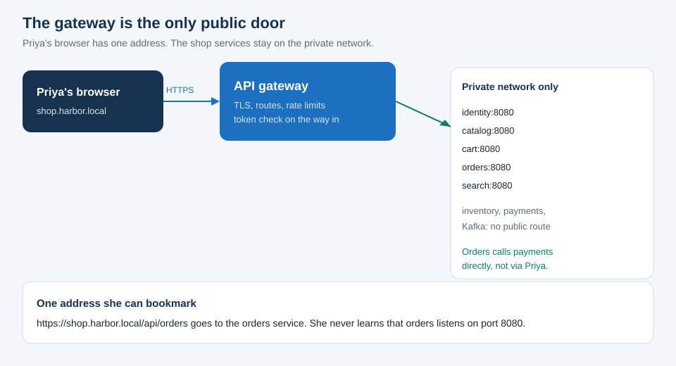
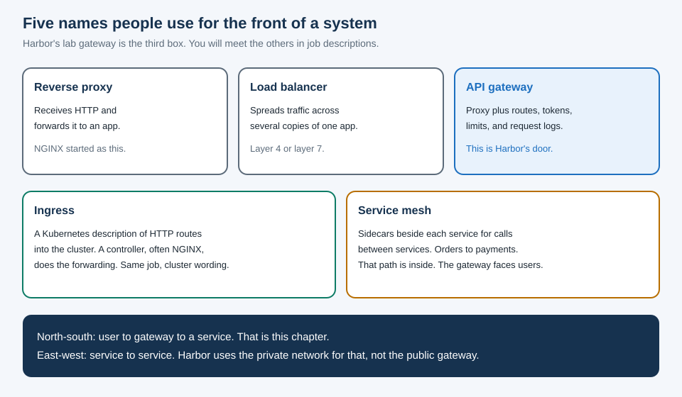
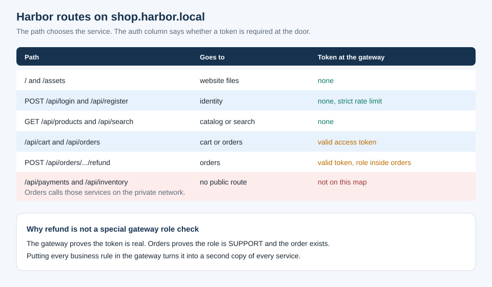
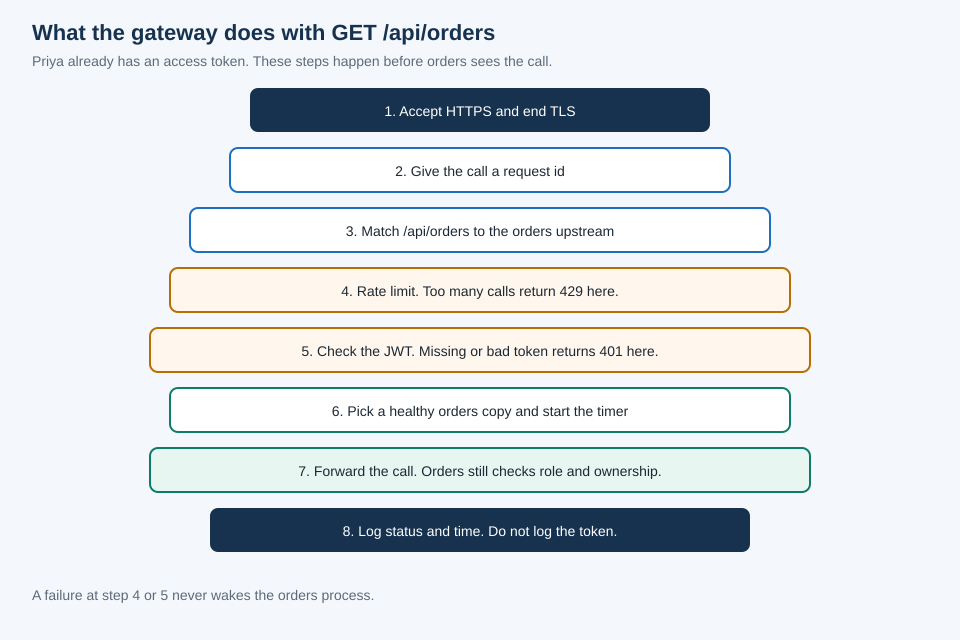
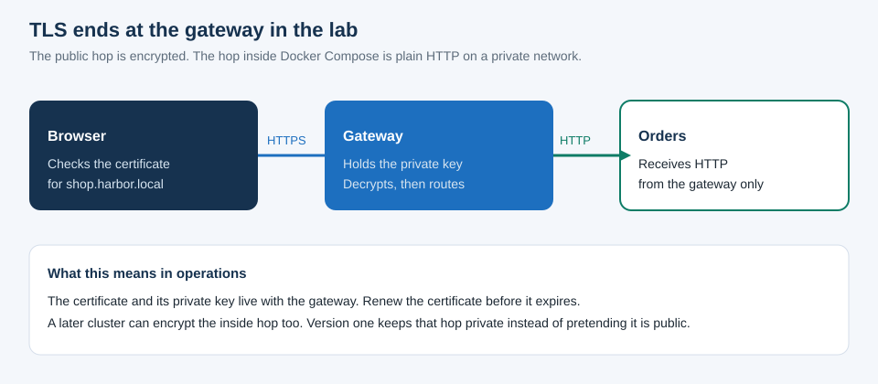
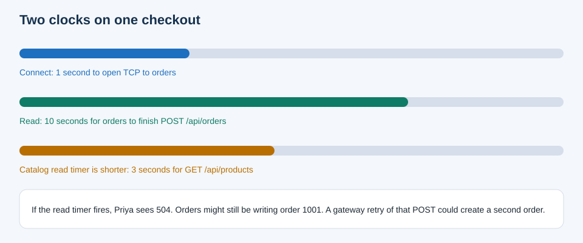
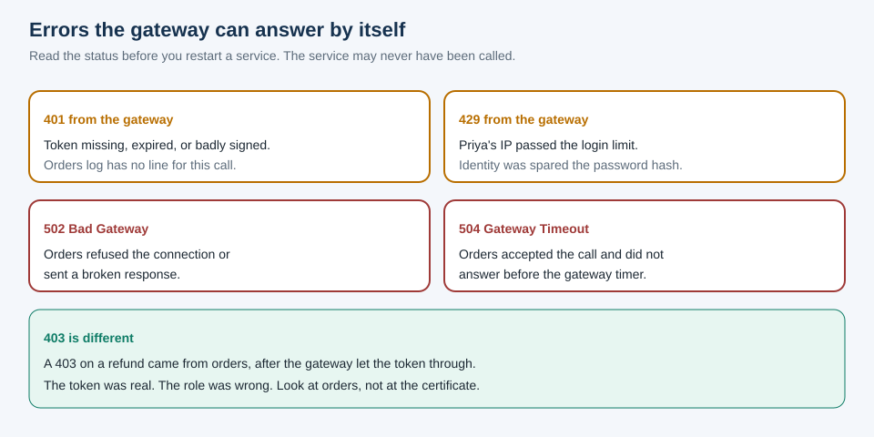

# Harbor Shop

The API gateway.

This chapter explains the single public door in front of Harbor Shop: what it is, what it does to one request, and the theory a DevOps engineer should be able to use in a design review.

The pictures live in the `images` folder. The identity rules this door enforces are in `01-product-architecture-and-identity.md`. This chapter does not rebuild that login design. It shows where the door sits around it.

Harbor's lab gateway is **NGINX**. Kong, a cloud API gateway, and a Kubernetes ingress are the same job in other clothes. They are explained here so you can recognize them. They are not installed in version one.

---

## 1. What this piece is

The API gateway is the only program Priya's browser can reach. She uses one name, `https://shop.harbor.local`. The gateway decides which private service should answer, and it refuses some calls before those services wake up.



Without a gateway, the website would need a public address for identity, another for catalog, another for cart, and another for orders. Every one of those would need its own certificate, its own login check, and its own rate limit. A new service would mean a new hole in the firewall. The gateway keeps that hole at one place.

The gateway does not own orders, passwords, or stock. It does not calculate Rs 2,499. It forwards a call that has already passed its checks, then returns whatever the service answered.

| The gateway does this | The service still does this |
|---|---|
| TLS for `shop.harbor.local` | The business rule |
| Choose identity, catalog, cart, orders, or search from the path | Read and write its own database |
| Limit how often a client may call | Role and ownership. Priya may not open order 1002. |
| Reject a missing or invalid access token on protected paths | Reject a valid token that has the wrong role (403) |
| Log the route, status, and time | Log what it changed, with the same request id |
| Time out a service that does not answer | Stay correct if the same request is delivered twice |

Inventory, payments, and Kafka have **no public route**. Orders calls them on the private network with a service token. Publishing `/api/payments` to the internet would let a browser try to charge a card. That URL is not on the map.

---

## 2. Names you will hear for the same neighborhood

People use five words for programs that sit in front of other programs. They overlap. Harbor's version one is an API gateway. The others are here so a job description is readable.



**A reverse proxy** accepts an HTTP request and forwards it to an application. The application is hidden behind it. NGINX became famous as a reverse proxy. "Reverse" distinguishes it from a forward proxy, which is a program a laptop uses to reach the internet. Harbor does not need a forward proxy.

**A load balancer** spreads work across several copies of one application. Two copies of orders can both be healthy. The balancer picks one.

- **Layer 4** balances TCP connections. It does not read the HTTP path. A cloud load balancer in front of the gateway is often layer 4.
- **Layer 7** reads HTTP. It can send `/api/orders` one place and `/api/products` another. An API gateway is a layer 7 balancer plus extra rules.

**An API gateway** is that layer 7 door with API habits: a route table, token checks, rate limits, request logs, and timeouts. Harbor's NGINX is configured to be this.

**An ingress** is the Kubernetes way to write the same HTTP routes. You declare "this host and path go to this service." An ingress controller, very often NGINX, performs the forwarding. When Harbor moves to Kubernetes, the lab gateway's routes become an ingress. The ideas in this chapter stay. The file format changes.

**A service mesh** (Istio or Linkerd are the names to remember) puts a small proxy beside every service. Those proxies handle calls **between** services: orders to payments, with a timeout, a retry policy, and a certificate on both sides. That traffic is **east-west**. User traffic into the cluster is **north-south**.

Version one uses the gateway for north-south traffic only. East-west traffic stays on the Docker network: orders opens HTTP to `payments:8080`. A mesh can wrap that hop later. The public gateway is still required, because a mesh sidecar is not what Priya's browser connects to.

**A BFF**, a backend for frontend, is a different idea again. A BFF is a small API shaped for one screen, sometimes joining catalog and cart into one response so the phone app makes one call. Harbor's gateway does not reshape JSON. It forwards. If a screen later needs a joined response, that is a new service, not a new rule inside NGINX.

| Product you will see at work | What it is in this vocabulary |
|---|---|
| NGINX, as Harbor runs it | The lab API gateway. Config is a file you can read. |
| Kong, Apache APISIX, Tyk | Gateway products. NGINX or a similar proxy underneath, plus plugins and an admin API. |
| AWS API Gateway, Azure API Management, Apigee | The same door, run by a cloud vendor. You pay per request and configure routes in their console or Terraform. |
| NGINX Ingress, Traefik, Envoy Gateway | Ingress controllers on Kubernetes. |
| Istio, Linkerd | Meshes for east-west traffic. |

Kong is the closest "ready-made gateway product," in the same way Keycloak is a ready-made login product. Version one stays with NGINX so every route, timeout, and limit is visible in one config file. Moving the same routes into Kong later does not change Priya's URLs.

---

## 3. The route table

One host. The path selects the upstream. An **upstream** is the private address of a service, such as `orders:8080` on the Compose network.



| Public path | Upstream | Token at the gateway | Limit in the lab |
|---|---|---|---|
| `GET /`, `GET /assets/...` | Files of the React site | No | Generous |
| `POST /api/register` | identity | No | 5 per minute per IP |
| `POST /api/login` | identity | No | 10 per minute per IP |
| `POST /api/refresh` | identity | No. The refresh token is the credential. | 30 per minute per IP |
| `POST /api/logout`, `GET /api/me` | identity | Access token | 60 per minute per user |
| `GET /api/products`, `GET /api/products/{id}` | catalog | No | 600 per minute per IP |
| `GET /api/search` | search | No | 300 per minute per IP |
| `/api/cart` | cart | Access token | 120 per minute per user |
| `GET /api/orders`, `POST /api/orders` | orders | Access token | 30 per minute per user |
| `POST /api/orders/{id}/refund` | orders | Access token | 10 per minute per user |
| `GET /health` on the gateway | the gateway itself | No | Used by Compose, then by Kubernetes |

`GET /.well-known/jwks.json` is how services and the gateway read identity's public keys. That URL is on the **private** network (`http://identity:8080/.well-known/jwks.json`). The browser does not need it. Leaving it off the public map is enough.

There is no route for:

- `/api/inventory`
- `/api/payments`
- `/api/notifications`
- identity's admin paths, except through `/api` routes already listed
- any port except 443, and port 80 only to redirect to 443

A request that matches nothing returns **404** from the gateway. Catalog never sees `/api/no-such-thing`.

### How a route is chosen

The gateway looks at three things, in order:

1. **Host.** `shop.harbor.local` is this shop. Any other host gets no routes. This blocks a client from sending `Host: localhost` and expecting the private names to work.
2. **Path.** The longest matching prefix wins. `/api/orders/1001/refund` is the orders route, not a one-segment catch-all.
3. **Method.** `GET /api/orders` and `POST /api/orders` both go to orders. `DELETE /api/products/kettle` is refused at the gateway if catalog has no public delete. Version one allows the methods each service documents, and rejects the rest with **405**.

Matching is exact about prefixes. `/api/orders` must not also swallow `/api/orders-extra` from a future service. A trailing-slash rule is written once and tested. Two routes that both claim the same path are a broken config, and the reload should be treated as a failed deploy.

---

## 4. The life of one request

Priya is logged in. Her website calls `GET /api/orders` with her access token. This is the path the gateway walks every time.



### Step 1. TLS

The browser opens a TCP connection to port 443 and completes a TLS handshake. The certificate must name `shop.harbor.local`. The gateway holds the private key. After the handshake, the gateway can read the HTTP request. That is **TLS termination**: encryption ends here, and the gateway sees the path and the headers.



Port 80 answers only with a redirect to `https://shop.harbor.local` plus the original path. A bookmark of `http://` still lands on HTTPS.

The certificate's private key is a secret, same class as the database password. A lab can use a locally created certificate that you trust on your machine. A real shop uses a certificate from a public authority and renews it before the expiry date. An expired certificate looks, to Priya, like the whole shop is down. Orders can be healthy the entire time.

Inside Compose, the gateway calls `http://orders:8080`. That network is not published to your laptop's LAN. Publishing `8080` on the host "for debugging" punches a hole beside the gateway. Debug with `docker exec` or a private admin channel, then close the port.

A company can add TLS on the inside hop later, often with a mesh. Version one does not pretend the Docker bridge is the public internet. The public hop is the one that must be HTTPS on day one.

### Step 2. A request id

The gateway creates an id, for example `c2f0a1b4-9d11-4a77-8e20-harbor`, and stores it in `X-Request-Id`. If the caller already sent one, the gateway may keep it only when it matches a safe pattern (a UUID). A caller must not be able to stuff log lines by sending a huge header.

Every service copies that id into its own logs. A support ticket that contains the id lets you find the gateway line, the orders line, and the payments line for the same click.

### Step 3. Match the route

`/api/orders` selects the `orders` upstream. The gateway now knows the timers, the token rule, and the rate-limit key for this path. An unknown path stops here with 404.

### Step 4. Rate limit

The limiter counts recent calls before any token work and before the upstream is touched.

Harbor uses a **token bucket** per key:

- The bucket holds a maximum number of tokens, the burst.
- Tokens are added back at a steady rate.
- One request spends one token.
- An empty bucket returns **429** with `Retry-After: 30` (seconds).

Example for login. The bucket holds 10 tokens and refills 10 per minute. Priya's ten tries in a rush succeed. The eleventh in that same minute receives 429. A minute later she has tokens again. Identity never hashed the eleventh password.

A **fixed window** ("10 per clock minute") is easier to explain and slightly unfair. Nine tries at 10:00:50 and nine at 10:01:05 are 18 tries in 15 seconds, because the window reset at 10:01:00. A token bucket does not reset on the clock. Name the token bucket in an interview. A fixed window is what you will still find in older configs.

The **key** is what you count:

| Route | Key | Why |
|---|---|---|
| Login, register | Client IP | She has no user id yet. The point is to slow guessing. |
| Orders, cart | `sub` from a valid token, and also the IP | One stolen token cannot scrape the shop at unlimited speed. The IP key still protects login. |
| Product list | Client IP | Public, read-only, a higher budget |

**Client IP** needs care. The gateway is the first public hop, so the TCP connection's source address is the client, or the company's load balancer. A header `X-Forwarded-For` sent by the browser is untrusted. The gateway overwrites it with the address it actually sees. If a cloud load balancer sits in front, you trust that balancer's header and nothing further left in the list. Trusting the raw header lets a client pretend to be a new IP on every try and skip the login limit.

Two gateway replicas with **in-memory** counters each allow the full budget. Two replicas and a "10 per minute" rule become about 20 per minute. A shared Redis counter is the fix when you run more than one gateway. One gateway in the lab can count in memory. Write the Redis note into the config comment before you scale out, so the limit does not silently double.

429 is a successful protection, not an outage. The dashboard should show it. An alert that pages you for a single 429 will train you to ignore alerts. An alert on a sudden spike of 429s on `/api/login` is a guessing attempt or a broken client.

### Step 5. The token check

Protected routes require:

```http
Authorization: Bearer <access token>
```

The gateway checks:

1. The header is present and shaped like a Bearer token.
2. The signature matches a key from identity's JWKS.
3. `iss` is `https://identity.harbor.local`.
4. `exp` is in the future, with about 30 seconds of clock leeway.
5. The algorithm is RS256, because the gateway was configured to accept RS256. It does not accept whatever `alg` the token claims.
6. The token id is not on the logout denylist in Redis.

Failure is **401**. The body is small and stable:

```json
{ "error": "invalid_token" }
```

The gateway caches JWKS for a few minutes. A Keycloak-style or identity key rotation still works, because the cache refreshes and the `kid` selects the key. A wrong issuer after a deploy (HTTP versus HTTPS, or a new host name) fails every protected call while `/api/products` still works. That split, public routes up and private routes 401, is the signature of a token-check problem.

The gateway then **forwards the same Authorization header**. Orders checks the token again and checks the role. Two doors, as in the identity chapter. The gateway does not take a client header called `X-User-Id` and believe it. If the gateway adds `X-User-Id` for logging, services ignore it for authorization. The id they trust is `sub` inside the verified token.

Public routes skip this step. `GET /api/products` is the kettle list. Anyone may read it.

`POST /api/login` skips it too. There is no token yet. The body contains the password. The gateway must not write that body to the access log. Logging request bodies is a common default that should be off for this shop.

### Step 6. Pick a copy and start the timer

The upstream `orders` may list more than one address:

```text
orders:
  server orders-1:8080
  server orders-2:8080
```

**Round robin** sends one request to each copy in turn. Harbor's services are stateless, so round robin is the right lab policy. **Least connections** prefers the copy with fewer open requests. **IP hash** sticks a client to one copy. Sticky sessions matter for an old app that keeps login state in memory. Harbor identity keeps refresh tokens in PostgreSQL, so sticky sessions would hide a bug rather than fix one.

**Active health.** The gateway calls `GET /health/ready` on each copy every few seconds. A copy that fails is out of rotation. Ready fails when that copy cannot reach its database. Liveness is not the check used for rotation. A process can be alive and still unable to take orders.

**Passive health.** Several 502s in a row also pull a copy out, briefly, even between active checks.

If every copy is out, the gateway returns **503** and does not wait for a timeout. Priya sees a clear failure. The orders database being down looks like this when readiness is wired correctly.

### Step 7. Forward, and do not retry a purchase

The gateway opens HTTP to the chosen copy, sends the method, path, query, and body, and waits.

Headers it sets:

| Header | Value |
|---|---|
| `X-Request-Id` | The id from step 2 |
| `X-Forwarded-For` | The client address the gateway believes |
| `X-Forwarded-Proto` | `https` |
| `Host` | The upstream host, or the original host, chosen once and kept stable |

`X-Forwarded-Proto: https` matters. The application builds links and cookies from the scheme it thinks the user used. If it sees plain HTTP, it may redirect Priya to `http://` or set a cookie that the browser will not send back. Identity's issuer stays `https://identity.harbor.local` either way. The website's own redirects follow `X-Forwarded-Proto`.

Headers it drops: `Connection` and other hop-by-hop headers that belong to one TCP connection, not to the next one.

Timers for the lab:

| Timer | Lab value | What expiry feels like |
|---|---|---|
| Connect | 1 second | Orders is not accepting TCP. Often a crash or a bad DNS name. **502** if the connection is refused. |
| Send (request body) | 5 seconds | Rare for JSON of this size. |
| Read, catalog and search | 3 seconds | Product list is stuck. **504**. |
| Read, login | 5 seconds | Hashing is slow on purpose. Do not set this to 200 milliseconds or every login becomes a 504. |
| Read, `POST /api/orders` | 10 seconds | Checkout talks to inventory and payments. **504** if they stall. |



**Retries.** The gateway may retry `GET /api/products` once, against another catalog copy, when the first copy refused the connection. It does **not** retry `POST /api/orders`, `POST /api/login`, or `POST /api/orders/1001/refund`.

A timed-out checkout is ambiguous. Orders may have saved order 1001 and then failed to answer in time. A gateway retry would send a second POST. The idempotency key inside orders and payments exists so a **client** retry is safe. The gateway is not that client. Priya's website may retry with the same key. The gateway must not invent a second attempt on its own.

### Step 8. The log line

One line per request, to stdout, as JSON. Example fields:

```json
{
  "request_id": "c2f0a1b4-9d11-4a77-8e20-harbor",
  "method": "GET",
  "path": "/api/orders",
  "status": 200,
  "route": "orders",
  "upstream_ms": 18,
  "total_ms": 21,
  "user": "8f3c2a10-priya"
}
```

`user` is the token `sub` after a successful check, not the email, and it is absent on a 401. The line does not contain the query string if the query can carry a token. Harbor puts tokens in the `Authorization` header, never in `?access_token=`. A token in a query string lands in logs, browser history, and referrer headers.

The response body is not logged. Order JSON is personal data. Login JSON contains a password on the way in and tokens on the way out.

---

## 5. Status codes, and who produced them



| Status | Who created it | Priya's case | First place you look |
|---|---|---|---|
| 200 or the service's own 4xx | The upstream, passed through | Order list, or 400 for an empty cart | That service's log, same request id |
| 401 | Gateway on a protected route | Expired 15-minute token | Refresh flow, issuer, JWKS, clock |
| 403 | Orders or another service | Priya calls refund | Role and ownership. The token was valid. |
| 404 | Gateway, or the service | Unknown path, or order id that is not hers | Gateway route table if the path should exist |
| 405 | Gateway | `DELETE /api/products` | Allowed methods on that route |
| 413 | Gateway | A huge body | Body limit, 1 MB for this shop's JSON |
| 429 | Gateway | Eleventh login this minute | Limit key, Redis if you run two gateways |
| 502 | Gateway | Orders process down, connection refused | Ready check, container, recent deploy |
| 503 | Gateway | No healthy copy in the upstream | Readiness of every copy, database |
| 504 | Gateway | Orders slower than the read timer | Downstream inventory or payments, not the certificate |

Pass-through means a 403 from orders is not rewritten into a 500 by the gateway. Changing status codes hides the service's decision.

A useful debug order when "the shop is down":

1. `GET /health` on the gateway. If this fails, you are looking at the gateway process or its host, not at orders.
2. `GET /api/products` with no token. If this works and `/api/orders` returns 401, routing and catalog are up. The failure is the token path.
3. `GET /api/orders` with a fresh token. A 502 or 504 here is orders or something orders calls.
4. Only then open the orders logs for that request id.

---

## 6. The website and the browser

The gateway also serves the React files: `index.html`, JavaScript, and CSS, under `/` and `/assets`. Those files are static. They do not run the shop. They call `/api/...` on the **same host**.

Same host means same origin. The browser treats `https://shop.harbor.local/` and `https://shop.harbor.local/api/orders` as one site. Cookies and scripts follow the normal same-site rules. You do not need a cross-origin setup for the production shop.

**CORS** (Cross-Origin Resource Sharing) appears when the page and the API differ by scheme, host, or port. A local UI on `http://localhost:5173` calling `https://shop.harbor.local` is a different origin. The browser sends a preflight `OPTIONS` request before `POST /api/orders`, and it expects response headers that name the allowed origin.

Lab choice when the UI runs on another port:

```text
Access-Control-Allow-Origin: http://localhost:5173
Access-Control-Allow-Headers: Authorization, Content-Type, X-Request-Id
Access-Control-Allow-Methods: GET, POST, OPTIONS
```

The allowed origin is that one dev URL, not `*`, once the request carries an `Authorization` header. A star with credentials is rejected by browsers anyway. Production, with the UI on the same host, does not need this exception.

`OPTIONS` is answered by the gateway and is not forwarded to orders. It is not a purchase. It does not spend a login rate-limit token. It can have its own small limit so a flood of preflights is still capped.

**Compression.** The gateway gzip-compresses JSON and the website's text files when the browser says it accepts gzip. Pictures that are already compressed are left alone. This cuts the product-list payload. It does not change the JSON the service produced.

**Body limit.** One megabyte is enough for register, login, cart, and checkout. A larger body is 413. Version one has no photo upload. Raising the limit "to be safe" mostly raises the size of a request someone can throw at the login route.

**HTTP versions.** HTTP/1.1 is enough for the lab. HTTP/2 on 443 is a reasonable addition because browsers multiplex many asset downloads. It does not change routes or auth. You can turn it on at the gateway without touching orders.

---

## 7. What a config file is doing

This is an illustration of the NGINX ideas above, not a file to copy into production unchanged. Names match the Compose network.

```nginx
upstream orders_upstream {
    server orders:8080;
    # a second copy would be another server line
}

server {
    listen 443 ssl;
    server_name shop.harbor.local;

    ssl_certificate     /certs/shop.crt;
    ssl_certificate_key /certs/shop.key;

    client_max_body_size 1m;

    location /api/orders/ {
        limit_req zone=orders_user burst=30 nodelay;

        auth_request /_auth;   # subrequest that checks the JWT

        proxy_pass http://orders_upstream;
        proxy_set_header Host $host;
        proxy_set_header X-Request-Id $request_id;
        proxy_set_header X-Forwarded-For $remote_addr;
        proxy_set_header X-Forwarded-Proto https;

        proxy_connect_timeout 1s;
        proxy_read_timeout    10s;
        proxy_next_upstream   error timeout http_502;
        # proxy_next_upstream is for failed connections.
        # Do not add non_idempotent. POST must not be retried.
    }

    location /api/products/ {
        proxy_pass http://catalog:8080;
        proxy_read_timeout 3s;
    }

    location /api/login {
        limit_req zone=login_ip burst=10 nodelay;
        proxy_pass http://identity:8080;
        proxy_read_timeout 5s;
    }
}
```

`auth_request /_auth` means: before serving `/api/orders/`, ask an internal location to validate the token. That internal location returns 401 or 204. Orders is contacted only after 204. Some teams validate the JWT inside NGINX with a module, and some put a tiny auth sidecar next to NGINX. The behavior Priya sees is the same. The identity service remains the signer. The gateway remains the checker.

**Reload, do not restart, for a route change.** `nginx -s reload` starts new workers with the new config and lets old workers finish their current requests. A restart drops those connections. A bad config must fail the reload and leave the old workers in place. The deploy step is: test the config (`nginx -t`), then reload, then request `/api/products` and a protected route.

Adding a service later is a fixed process:

1. The service has `/health/live` and `/health/ready`.
2. Its port is reachable on the private network and is not published on the host.
3. Add an upstream and a `location` with a method list, a timer, a body limit, and a rate limit.
4. Decide whether the route is public or token-protected.
5. `nginx -t`, then reload.
6. From outside, confirm the new path works and the raw service port does not.
7. Confirm a missing token gets 401 on that path, and a `GET` of a public path still needs no token.

---

## 8. What you operate

| Item | Lab choice | What breaks when it is wrong |
|---|---|---|
| Public ports | 443, and 80 for redirect | An open 8080 bypasses every control in this chapter |
| Certificate | Local name `shop.harbor.local` | Expired or wrong name: the browser stops before HTTP |
| Private key | File mounted as a secret | A key in Git is a leaked certificate |
| Config | One file in Git, reloaded | A route that exists only on one person's laptop |
| JWKS cache | A few minutes | A very long cache delays key rotation. A zero cache hammers identity. |
| Clocks | NTP on the gateway host | Tokens look expired or unexpired for the wrong reason |
| Rate-limit store | Memory for one gateway. Redis before the second replica. | Limits multiply with replicas |
| Access log | stdout, no bodies, no tokens | A disk full of logs, or a password in a log platform |
| Metrics | Request rate, p95 latency, 401, 403, 429, 502, 504, per route | You can only see "it feels slow" |
| Readiness of upstreams | Poll `/health/ready` | Traffic keeps entering a copy whose database is down |
| Gateway's own health | `GET /health` does not call orders | The platform restarts a healthy gateway because orders is down |

Dashboards worth having on day one:

- Requests per second by route
- p95 of `upstream_ms` by route
- 401 rate on `/api/orders` (token trouble) separate from 401 on `/api/login` (wrong password, which is identity's status, passed through)
- 429 on `/api/login`
- 502 and 504 by upstream
- Count of healthy upstream copies

**Two gateways.** Put a layer 4 load balancer, or a Kubernetes Service, in front of them. Both use the same config and the same certificate. Rate limits move to Redis. JWKS cache is per gateway, which is fine. There is no session to stick. Draining a gateway means "stop sending new connections, let current ones finish," which is the same idea as an NGINX reload.

**Certificate renewal.** Know the expiry date. Renew, place the new files, reload. A reload picks up a new certificate without dropping the route table. Practice this once in the lab with a certificate that lives for two days, so the steps are boring before they are urgent.

**Upgrades of NGINX.** Read the release note, reload in the lab, run the route tests: public product list, login limit, 401 without a token, 200 with a token, 504 behavior left as a unit test if you can simulate a slow upstream. The shop services do not redeploy just because the gateway did.

---

## 9. Failures, with the kettle still in the story

| What Priya sees | What is true | What you do |
|---|---|---|
| Browser says the certificate is not trusted or has expired | TLS ended before step 3 | Renew or install the cert. Orders can be healthy. |
| Product pages load. My Orders says 401. | Gateway token check is failing, or her access token expired and refresh failed | Compare `iss`, JWKS, and the gateway clock. Then the refresh route. |
| Login returns 429 on the first try of the day | Her IP is shared, or the limit key is wrong, or many gateways are not the cause and the limit is simply too low | Check the key. A NAT can make a whole office look like one IP. |
| Checkout spins, then 504 | The read timer fired. Order 1001 might exist. | Find the request id in orders, inventory, and payments. Do not retry from the gateway. Let her client retry with the same idempotency key. |
| Checkout returns 502 | The gateway could not get a valid HTTP response | Orders container, ready check, recent deploy |
| Refund returns 403 | Token was good enough for the gateway | Arun's role in identity, and whether this token was issued before the role was granted |
| She can open `http://localhost:8082` and skip the gateway | A service port is published | Remove the host port. Repeat the request. It should fail. |
| After a config reload, every path 404 | The new file replaced the routes | `nginx -t` on the previous file, restore, reload. A failed `nginx -t` should have blocked this. |

Login 401 and gateway 401 are easy to mix up in a log search.

- Identity returns 401 on `POST /api/login` when the password is wrong. The gateway passed the call through. The upstream status is 401.
- The gateway returns 401 on `GET /api/orders` when the bearer token is bad. Upstream status is empty, because orders was not called.

Store both "status sent to the client" and "status from the upstream" so those two 401s do not become one chart.

---

## 10. How this sits on Kubernetes, later

When the shop moves off Compose, the same design becomes:

| Lab on Compose | Later on Kubernetes |
|---|---|
| NGINX container, config file | Ingress resource plus an ingress controller |
| `orders:8080` on the Compose DNS | Service `orders` on the cluster DNS |
| Published port 443 | A LoadBalancer or an ingress controller Service on 443 |
| Readiness by polling the upstream | Readiness probe on the pod, and the Service sends traffic only to ready pods |
| Redis for limits if you run two NGINX | The same Redis, or the controller's shared limit |

The route table in section 3 is the ingress content. TLS termination, request ids, 401 at the door, and no public payments URL all stay. An ingress controller that cannot check a JWT needs a small auth subrequest, the same `auth_request` idea, or you terminate tokens at a gateway in front of the ingress. Pick one door for the token check. Two products that both think they are the only door produce double limits and confusing 401s.

East-west policy ("only orders may call payments") is a network policy or a mesh rule. It is not an ingress path. Write it down when the cluster exists. Version one enforces it by not publishing the port and not creating a public route.

---

## 11. What you should be able to say without notes

- Priya has one name, `https://shop.harbor.local`. The gateway is the only public door.
- A path chooses the upstream. Payments and inventory have no public path.
- North-south is user to gateway. East-west is orders to payments, and it does not go out through the public door.
- The gateway checks the access token on protected routes and still forwards it. The service checks the role. 401 is the door. 403 is the service.
- Login and register are public and strictly rate limited. The limit key for login is the client IP, and that IP is not whatever the client wrote in a header.
- The gateway may retry a failed GET to catalog. It does not retry POST /api/orders.
- 502 means it could not get a valid response. 504 means the read timer fired. 429 means the limit held. None of those require a database restore as the first move.
- NGINX is the lab gateway. Kong, cloud gateways, and ingress controllers are the same role elsewhere. A service mesh is the inside hop, not a replacement for this door.

---

## 12. Next chapter

The gateway assumes every service exposes health, a port, and logs with the request id. The next note can be:

- The runtime contract: port, health, config, logs, and the request id, for every language in the shop
- Catalog and inventory, including the stock reservation orders triggers after the gateway has already let Priya in
- Orders, the saga, and the idempotency key that makes her retry safe when the gateway has already refused to retry for her
